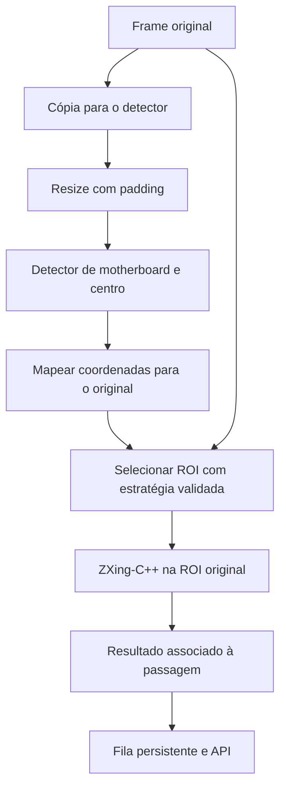

# Trilha de estudo para o experimento PAIC

O objetivo é conseguir explicar e implementar cada etapa entre a fotografia de um
painel e o registro de uma passagem na esteira. Vamos primeiro observar e testar
operações pequenas, depois integrá-las ao experimento. A próxima entrega técnica
continua sendo o carregador PyTorch com alvos por grade definido no `AGENTS.md`.

## A didática que vamos usar

O [espaço de estudos do VC_iREDE](https://github.com/luix-felipe/VC_iREDE/blob/66940cd6f6aca77dfee9ecc167eaef29986ff388/rascunhos/README.md)
combina explicações, exemplos numéricos, execução e interpretação. Seus
[laboratórios](https://github.com/luix-felipe/VC_iREDE/blob/66940cd6f6aca77dfee9ecc167eaef29986ff388/rascunhos/laboratorios/README.md)
acrescentam funções para completar, dicas graduais e verificações. Vamos adaptar
esse formato com três entregas por assunto:

| Material | Como estudar | Resultado esperado |
|---|---|---|
| Aula guiada | Ler a pergunta, prever a saída e executar uma célula por vez | Explicar os dados, a operação e o resultado |
| Laboratório | Completar uma função curta e usar os verificadores | Implementação própria e análise de um erro |
| Registro do experimento | Repetir uma comparação controlada e registrar condições | Evidência que sustenta uma decisão do projeto |

O assunto técnico de uma aula do VC_iREDE pode pertencer a outro problema.
Por exemplo, inspeção de defeitos de componentes e segmentação por máscaras
aparecem naquela referência. Aqui usamos `motherboard`, centro do painel, ROI
geométrica e ZXing-C++; a rede não vai ler os caracteres do Data Matrix.

Em nossas sessões, seguiremos esta sequência:

1. Definir uma pergunta e o contrato de entrada e saída, com unidades e formatos.
2. Fazer uma previsão e uma conta com poucos números.
3. Implementar ou executar a menor operação que verifica a previsão.
4. Conferir a imagem e os testes; investigar um caso que deve falhar.
5. Alterar um parâmetro e explicar a diferença.
6. Registrar a conclusão, sua condição de validade e o próximo passo.

Podemos trabalhar um bloco por sessão. O tempo de estudo será ajustado à sua
disponibilidade; os critérios abaixo, e não uma carga horária, orientam o avanço.

## Fluxo do sistema que queremos compreender



A seleção automática da ROI permanece uma questão de pesquisa: uma classe única
não distingue os três layouts. Na aprendizagem e nos ensaios atuais, usamos
anotações ou ROIs manuais explicitamente identificadas como tal.

Durante a preparação do treino existe outro caminho:

```text
Manifesto revisado → divisão por peça → imagem sob demanda
→ resize com padding → augmentation somente no treino
→ transformar caixa e centro → gerar grade-alvo → conferir visualmente
```

A anotação é a resposta conhecida usada para ensinar. A predição será uma saída
da rede. Uma figura do centro anotado ou da grade esperada mostra a supervisão,
sem demonstrar que um detector aprendeu a tarefa.

## Sequência das atividades

As etapas 00 e 01 já têm material de estudo nesta pasta e em `notebooks/`.
As demais são o roteiro dos próximos incrementos, apoiados pelos scripts existentes.
Não há notebooks de treinamento nem um modelo pronto nesta entrega.

| Etapa | Pergunta e prática | Ferramentas e código | Critério para avançar |
|---|---|---|---|
| 00 Ambiente | Qual Python executa minha célula? Instalar o ambiente e conferir o kernel | [Preparação](tools_setup.md), `sys.executable`, `pip` | Identificar executável e versões; explicar terminal e kernel |
| 01 Imagens e coordenadas | Como pixels, caixa, centro e padding se relacionam? | [Aula](../notebooks/aulas/01_imagens_e_coordenadas.ipynb), [laboratório](../notebooks/laboratorios/01_imagens_e_coordenadas.ipynb), NumPy, OpenCV | Implementar centro e recorte válido; explicar BGR/RGB e inverter uma transformação |
| 02 Dataset e grupos | O que é uma peça independente? Conferir manifesto, fotos e faces | `config/blanks_annotations.yaml`, `scripts/prepare_blanks.py` | Explicar `class_name`, `piece_id` e `side_id`; demonstrar que as peças não atravessam a divisão |
| 03 Transformações | O que muda na imagem e no rótulo quando aplico augmentation? | `scripts/augmentation.py`, `config/augmentation.example.yaml`, [guia existente](first_augmentation.md) | Reproduzir a semente e alinhar pixels, caixa e centro; identificar corte rejeitado |
| 04 Dataset PyTorch e grade | Como uma amostra anotada vira tensores e uma resposta espacial? | `Dataset`, `DataLoader`, conversão RGB e grade de inteiros | Conferir treino aumentado e validação determinística; executar todos os critérios da seção 11 do `AGENTS.md` |
| 05 CNN e otimização | Como filtros e parâmetros passam a produzir a grade? | `torch.nn`, autograd, perda e laço próprios | Explicar `forward`, perda, gradientes e atualização; concluir uma execução curta de verificação |
| 06 Comparação experimental | Augmentation muda os resultados sob o mesmo protocolo? | Mesmas divisões, sementes, orçamento e avaliação; SSCMA como referência posterior | Separar efeito observado de hipótese e documentar diferenças em relação ao FOMO/MobileNetV2 0.35 |
| 07 ROI e leitura | O centro permite encontrar o código correto no original? | `scripts/experiment_blanks.py`, ZXing-C++, calibração geométrica | Selecionar a ROI por uma estratégia validada e confrontar a leitura com conteúdo esperado independente |
| 08 Inferência embarcada | A conversão preserva a saída e cabe na Pi 3? | TFLite/LiteRT, entradas fixas, quantização quando avaliada | Comparar PC/runtime e medir latência, memória e leitura no hardware disponível |
| 09 Passagem e entrega | Como contar uma peça uma vez e tolerar falha de rede? | Fonte gravada, rastreamento ou sensor, SQLite, HTTP e mocks | Um evento por passagem, persistência e retentativa com o mesmo `event_id`; validar fisicamente na esteira |

Esses critérios são portas de avanço didáticas, não metas de acurácia, FPS ou
consumo. A velocidade da esteira, a câmera, o sensor e o contrato da API ainda
precisam ser definidos. A compatibilidade da exportação PyTorch → TFLite/LiteRT
também exige demonstração antes da adoção no hardware.

## Primeira sessão

1. Siga a instalação do [ambiente de estudo](tools_setup.md).
2. Abra `notebooks/aulas/01_imagens_e_coordenadas.ipynb` no VS Code.
3. Selecione o Python de `.venv-study` como kernel e confira `sys.executable`.
4. Faça as previsões antes de executar os exemplos sintéticos de imagem e ROI.
5. Veja a fotografia real na última parte da aula. A miniatura é apenas uma
   visualização; os números da caixa sintética não são anotações dessa foto.
6. No laboratório correspondente, complete o primeiro exercício. O estado
   `PENDENTE` é esperado enquanto houver `NotImplementedError`.
7. Salve suas respostas no notebook. Ao terminar uma tentativa, reinicie o kernel
   e execute novamente na ordem para conferir que o estado anterior não a ocultava.

O notebook de aula contém as explicações completas. No laboratório, tente primeiro,
abra a primeira dica se necessário e consulte a aula depois de localizar sua dúvida.
Um verificador aprovado cobre os exemplos declarados; sua explicação e a inspeção
visual continuam fazendo parte da atividade.

## Como chegar ao próximo incremento

Depois da primeira aula, retome os comandos existentes na raiz, usando o
ambiente do leitor descrito em [ferramentas](tools_setup.md):

```powershell
.\.venv\Scripts\python.exe -m scripts.prepare_blanks catalog
.\.venv\Scripts\python.exe -m scripts.prepare_blanks folds
.\.venv\Scripts\python.exe -m scripts.prepare_blanks preview --image 20261112_084042.jpg
```

Abra o catálogo e confira as caixas. Leia `piece_folds` e preveja a quantidade de
fotos antes de abrir `artifacts/blanks-folds.json`: deixar `piece_01` fora produz
19 fotos de treino e 4 de validação; `piece_02`, 15 e 8; `piece_03`, 12 e 11.
Todas as faces de cada peça devem acompanhar o grupo. Os arquivos em `artifacts/`
são derivados e podem ser regenerados.

Na etapa 04, implementaremos em partes:

1. Leitura e validação do manifesto; abertura de uma imagem por acesso.
2. Seleção de uma divisão por peça e política explícita para as sete fotos com
   `edge_contact`, registrando inclusão ou exclusão.
3. Resize com padding configurável e representação RGB `float32`, com eixos e
   normalização documentados; coordenadas permanecem explícitas.
4. Augmentation só no treino e composição/inversão das transformações.
5. Grade `(altura // fator, largura // fator)`, inteira, indexada `[linha_y, coluna_x]`:
   fundo `0` e célula do centro `1`. Para centro válido, coluna é `floor(x/fator)`
   e linha é `floor(y/fator)`; `x == largura` ou `y == altura` é inválido.
6. Visualização e testes de alinhamento, bordas, padding, arredondamento,
   reprodução, falhas e ausência de vazamento. Só depois usaremos a CNN.

Exemplo apenas didático: entrada 128 × 128, fator 16 e centro `(40, 70)` geram
grade 8 × 8 e célula `[4, 2]`. Isso não fixa a entrada do treino. A grade é
supervisão por centro e não uma máscara da área do painel. Antes de comparar
com SSCMA, verificaremos seus alvos e perda na revisão utilizada; a semelhança
visual da saída não comprova equivalência de implementação.

## Do estudo ao experimento real

Um exemplo sintético permite saber a resposta exata e localizar um erro. Uma
foto gravada permite testar uma imagem real sem depender da câmera. A bancada
introduz foco, iluminação, resolução e sincronização. A esteira acrescenta
movimento, espaçamento e associação entre frames e passagem. Cada etapa precisa
de evidências próprias.

O acervo atual contém uma peça por layout. Ao validar por peça, também deixamos
um layout inteiro fora do treino. As 23 fotos e suas transformações não demonstram
generalização para novos exemplares. Precisamos coletar outras peças, sessões e
imagens sem motherboard; os periféricos ainda não estão anotados nem aprovados
como negativos para o protocolo.

A leitura em duas de quatro fotos, registrada no README, é um ensaio anterior
com ROIs manuais. Ainda precisamos de referência do código esperado. Investigar
as duas falhas pode ocorrer em paralelo ao estudo do detector: inferência melhor
não recupera automaticamente um símbolo desfocado ou cortado.

Para cada comparação use o [modelo de registro](experiment_record.template.md).
No hardware, registre também p50/p95, vazão, RAM/CPU, leituras corretas, perdas e
duplicidades, conforme o `AGENTS.md`. Treino ocorre no PC/servidor; a Pi recebe
apenas o runtime e as dependências de inferência e aplicação validadas.

## Organização dos materiais e verificação

`notebooks/aulas/` contém exemplos explicados; `notebooks/laboratorios/` guarda
suas implementações e respostas. Os scripts existentes continuam sendo o código
reutilizável do projeto. Ao estabilizar uma implementação, vamos incorporá-la em
pequenos passos, com testes críticos, e fazer a aula apontar para esse código.
Resultados derivados ficam em `artifacts/`; decisões e registros sem dados reais
sensíveis podem ser versionados em `docs/`.

Na preparação desta trilha, as células da primeira aula foram verificadas no PC
com Python 3.12.10, NumPy 2.5.2, OpenCV 5.0.0.93 e Matplotlib 3.11.1.
O laboratório foi verificado vazio e com soluções temporárias de referência,
mantendo os exercícios distribuídos sem solução. Detalhes da verificação estão
no [guia dos notebooks](../notebooks/README.md).

A instalação limpa de `requirements-study.txt`, a interface interativa do VS Code,
o PyTorch e o hardware ainda exigem verificação. O ambiente do leitor documentado
no README é outro; essas versões não atualizam seus resultados históricos.
